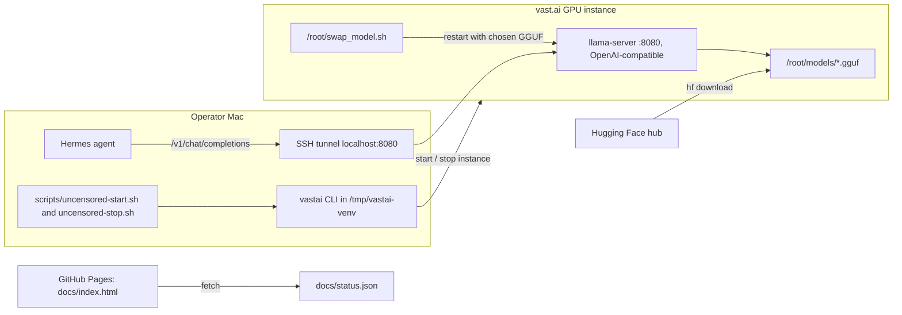

# AI Uncensored: self-hosted uncensored coding models

Run abliterated (0-refusal) coding models on a rented vast.ai GPU with llama.cpp.
Wire the box into Hermes as an OpenAI-compatible provider. No hosted model API involved.
For operators who want their own uncensored model endpoint for security and coding work.

## Logs

- [CHANGELOG.md](CHANGELOG.md): release notes, newest first.
- [PROMPTLOG.md](PROMPTLOG.md): rules and prompts that shaped this repo.

## Status

| Field | Value |
|---|---|
| Version | v0.1.0 |
| Date | 2026-10-14 |
| Updated by | hermes-agent for emino |
| Default branch HEAD | `c0b7b601` (main) |
| Model box | vast.ai GPU instance, started and stopped by hand with `scripts/` |
| Status dashboard | `docs/` on `main`, served by GitHub Pages: https://eminogrande.github.io/ai-uncensored-selfhost/ |
| Deployment | No CI, no deploy workflow. Everything is manual. |

Last recorded live state (`docs/status.json`, updated 2026-08-31): Qwen3.8-27B OBLITERATED V3 Q6_K on an NVIDIA A100-PCIE-40GB, context 262144, about 33 tok/s gen, 1106 tok/s prompt. Whether the box is running today is UNVERIFIED.

Note: the Setup section below still describes the original V100 path (64K context, Q4_K_M). `scripts/swap_model.sh` now uses Q6_K for `obl` and a 131072 context. Adjust `-c` to your GPU.

## Architecture



## User flow

```mermaid
sequenceDiagram
  participant Op as Operator
  participant VA as vast.ai
  participant Box as GPU box
  participant Hm as Hermes
  Op->>VA: uncensored-start.sh CONTRACT_ID
  VA-->>Op: instance running, new port and IP
  Op->>Box: open SSH tunnel to 127.0.0.1:8080
  Op->>Box: swap_model.sh obl, hui or r1
  Box-->>Op: llama-server up, curl /health
  Op->>Hm: hermes chat --provider v100-local
  Hm->>Box: POST /v1/chat/completions via tunnel
  Box-->>Hm: completion
  Op->>VA: uncensored-stop.sh CONTRACT_ID, disk and models kept
```

## Components

| Component | Path | Role |
|---|---|---|
| Model swapper | `scripts/swap_model.sh` | Runs on the box. Kills llama-server, restarts it with the `obl`, `hui` or `r1` GGUF on :8080. |
| Start script | `scripts/uncensored-start.sh` | Runs on the Mac. `vastai start instance <contract_id>`, models stay on disk. |
| Stop script | `scripts/uncensored-stop.sh` | Runs on the Mac. `vastai stop instance <contract_id>`, keeps the disk. |
| Status dashboard | `docs/index.html` | Static page. Renders live model, query example, model list, access note. |
| Status data | `docs/status.json` | Hand-edited state: live model, GPU, cost, endpoint, models. |
| Guide | `README.md` | Setup, model notes, cost reference. |

## API / Endpoints

This repo has no server code of its own. The box runs stock `llama-server`. Endpoints used by this repo:

| Method | Path | Auth | Purpose |
|---|---|---|---|
| POST | `/v1/chat/completions` | none, reachable only through the SSH tunnel | OpenAI-compatible chat, used by Hermes and the dashboard curl example |
| GET | `/health` | none, via tunnel | Server readiness check after a swap |

CLI commands:

| Command | Args | Purpose |
|---|---|---|
| `swap_model.sh` | `obl` / `hui` / `r1` | Serve Qwen3.8-27B OBLITERATED Q6_K / Huihui Qwen3.8-27B Q4_K / DeepSeek-R1-Distill-Qwen-32B Q4_K_M (ctx 8192) |
| `uncensored-start.sh` | `<contract_id>` | Start a stopped vast.ai instance |
| `uncensored-stop.sh` | `<contract_id>` | Stop the instance, keep the disk |

The endpoint has no API key. Do not expose port 8080 publicly without adding `--api-key`.

## Run

No package manager, no tests, no build in this repo. Requirements: Python 3.13 venv with `vastai`, an SSH key, a vast.ai account.

```bash
# vastai CLI where the scripts expect it
python3.13 -m venv /tmp/vastai-venv && /tmp/vastai-venv/bin/pip install vastai

# start / stop the box
bash scripts/uncensored-start.sh <CONTRACT_ID>
bash scripts/uncensored-stop.sh <CONTRACT_ID>

# on the box: pick a model, then check health
/root/swap_model.sh obl
curl http://127.0.0.1:8080/health
```

Env vars read by the scripts: none. Paths are hardcoded (`/tmp/vastai-venv/bin/vastai`, `/root/llama.cpp/build/bin/llama-server`, `/root/models/`).

## TL;DR

- **V100 (Volta, sm_70) = llama.cpp/GGUF only.** KTransformers requires sm_80+
  (Ampere); its kt-kernel explicitly marks Volta unsupported. vLLM 0.20.0+ dropped sm_70.
  The "run KTransformers on a V100" idea does not work. llama.cpp built for
  sm_70 is the only practical serving path.
- Best runnable uncensored coder on a single V100: **Qwen3.8-27B OBLITERATED**
  (~30 tok/s, 64K context).
- Best runnable uncensored coder on a big-RAM box (128GB+ RAM, 75GB+ disk):
  **DeepSeek V4 Flash abliterated** (88.8% SWE-bench, 284B MoE / 13B active).
- Best uncensored coder, period: **GLM-5.3 UNCENSORED FP8** (dealignai, 95.4%
  SWE-bench). 753B, needs 8xH200, not self-hostable on a budget.

## Models tested

Benchmarked on a V100-32GB, llama.cpp `b1-557614e`, full GPU offload (`-ngl 99`).

| Model | Type | Gen t/s | Prompt t/s |
|---|---|---|---|
| `OBLITERATUS/Qwen3.8-27B-OBLITERATED` Q4_K_M | uncensored coder | 30.6 | 725 |
| `huihui-ai/Huihui-Qwen3.8-27B-abliterated` Q4_K | uncensored | 30.3 | 715 |
| `bartowski/DeepSeek-R1-Distill-Qwen-32B-abliterated` Q4_K_M | reasoning | 27.2 | 645 |

Later run on A100-PCIE-40GB (`docs/status.json`): OBLITERATED V3 Q6_K, 33 gen t/s, 1106 prompt t/s, 262144 context.

Uncensored verified live: the OBLITERATED model answers restricted requests
(no refusals, no safety-lecture deflections).

## Hardware reality (why llama.cpp)

| GPU | Compute capability | KTransformers | vLLM 0.20+ | llama.cpp |
|---|---|---|---|---|
| V100 | 7.0 (Volta) | no | no, dropped | yes (build for sm_70) |
| A100 | 8.0 (Ampere) | yes | yes | yes |
| H100 | 9.0 (Hopper) | yes | yes | yes |

## Setup

### 1. Rent a V100-32GB on vast.ai

```bash
python3.13 -m venv /tmp/vastai-venv && /tmp/vastai-venv/bin/pip install vastai

# find a 32GB V100
/tmp/vastai-venv/bin/vastai search offers 'gpu_name=Tesla_V100 gpu_ram>=32000' -o 'dph_total'

# rent on-demand (--disk applies reliably on on-demand, unlike interruptible bids)
/tmp/vastai-venv/bin/vastai create instance <OFFER_ID> \
  --image nvidia/cuda:12.4.0-devel-ubuntu22.04 --disk 80 --ssh --direct

# wait for 'running', then grab ssh host/port/direct_port_start
/tmp/vastai-venv/bin/vastai show instance <CONTRACT_ID>
```

### 2. Build llama.cpp for sm_70

```bash
ssh -p <PORT> -i ~/.ssh/id_ed25519 root@<HOST> 'bash -s' <<'EOF'
apt-get update -qq && apt-get install -y -qq git build-essential cmake
git clone --depth 1 https://github.com/ggml-org/llama.cpp.git
cd llama.cpp
cmake -B build -DGGML_CUDA=ON -DCMAKE_CUDA_ARCHITECTURES=70 -DCMAKE_BUILD_TYPE=Release
cmake --build build --config Release -j 8
EOF
```

On an A100 use `-DCMAKE_CUDA_ARCHITECTURES=80`.

### 3. Download + serve

```bash
ssh -p <PORT> -i ~/.ssh/id_ed25519 root@<HOST> 'bash -s' <<'EOF'
pip3 install -q huggingface_hub
hf download OBLITERATUS/Qwen3.8-27B-OBLITERATED \
  Qwen3.8-27B-OBLITERATED-Q4_K_M.gguf --local-dir /root/models
EOF

# serve, OpenAI-compatible on :8080
/root/llama.cpp/build/bin/llama-server \
  -m /root/models/Qwen3.8-27B-OBLITERATED-Q4_K_M.gguf \
  -ngl 99 -c 65536 --host 0.0.0.0 --port 8080 \
  --temp 0 --repeat-penalty 1.15 --reasoning off
```

> **`--reasoning off` is mandatory** for these abliterated Qwen3.8 GGUFs. With the
> default `--reasoning auto`, the model enters a degenerate thinking loop
> (streams `reasoning_content: "/"` forever, never emits an answer). Non-streaming
> requests happen to mask this; streaming (which Hermes uses) exposes it.
> `scripts/swap_model.sh` also adds `--jinja` and uses temp 0.7 (not 0) to avoid degeneration.

### 4. Wire into Hermes

```bash
# tunnel (keep alive in a separate terminal)
ssh -p <PORT> -i ~/.ssh/id_ed25519 -L 8080:127.0.0.1:8080 root@<HOST> -N

# register the provider (CLI only, never hand-edit config.yaml)
hermes config set providers.v100-local '{
  "name":"V100 Uncensored (vast.ai)",
  "api":"http://127.0.0.1:8080/v1",
  "transport":"chat_completions",
  "default_model":"qwen3.8-27b-obl",
  "context_length":65536,
  "models":{
    "qwen3.8-27b-obl":{"context_length":65536},
    "huihui-qwen38-27b":{"context_length":65536},
    "deepseek-r1-32b-abl":{"context_length":65536}
  }
}'

# test
hermes chat -q "reply with exactly: OK" --provider v100-local -m qwen3.8-27b-obl -Q
```

> Hermes enforces a 64K minimum context. The server must run `-c >= 65536`.

## Swap models

`scripts/swap_model.sh` restarts llama-server with a different GGUF
(`obl` / `hui` / `r1`). Only one 27B+ model fits in VRAM at a time.

```bash
ssh -p <PORT> -i ~/.ssh/id_ed25519 root@<HOST> /root/swap_model.sh obl
```

## Uncensored maker landscape

| Maker | Technique | Capability vs base |
|---|---|---|
| huihui-ai | abliteration (SVD on refusal directions) | some loss |
| OBLITERATUS (elder-plinius) | SVD + LEACE complementary blend, iterative | -2.1pp MMLU |
| dealignai | residual-writer tensor edit ("CRACK"), FP8 experts untouched | **+1.85pp MMLU** |

dealignai's method is the most interesting: it *improves* capability while
removing refusals, and loads in stock vLLM. Watch for a 35B-or-smaller dealignai release.
That would be the best runnable uncensored coder.

## Cost reference (vast.ai, live Aug 2026)

| Card | Spot $/hr | On-demand $/hr | Notes |
|---|---|---|---|
| V100 32GB | ~0.12 | ~0.16 | sm_70, llama.cpp only |
| A100 PCIe 80GB | ~0.13 | ~0.43 | sm_80, unlocks vLLM/KTransformers |
| A100 PCIe 40GB | n/a | ~0.60 | recorded in `docs/status.json` |
| RTX 4090 24GB | ~0.07 | ~0.32 | cheapest fast consumer card |

Spot = interruptible (can be reclaimed mid-inference). On-demand `--disk` sizing
is reliable; interruptible bids sometimes ignore `--disk` (observed on vast.ai).

## License

MIT (stated here; no LICENSE file in the repo). Models carry their own licenses (Qwen Apache-2.0, DeepSeek MIT); abliterated
derivatives inherit the base license. You are responsible for how you use them.
